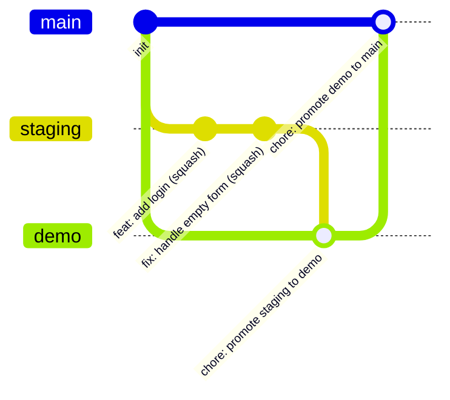

# tanstack-monorepo-template

[](https://github.com/azurioh/tanstack-monorepo-template/actions/workflows/ci.yml)
[](./LICENSE)

A GitHub template for TypeScript monorepos whose web apps run on TanStack Start. It ships the
foundation every project needs before the first feature: workspace layout, strict quality gates,
Conventional Commits, automated releases and dependency updates, branch protection as code, and a
set of Architecture Decision Records that explain every choice.

## Why

Starting a project usually means a day of wiring linters, hooks, CI, branch rules and release
tooling, then re-arguing the same decisions in the next project. This template makes those
decisions once, writes them down, and lets a new repository be protected and green within minutes
of being created.

## What's included

- **Monorepo**: pnpm 12 workspaces and Turborepo 2, `apps/` for deployable units and `packages/`
  for shared code under the `@repo/*` scope.
- **Runtime and language**: Node.js 24 LTS (pinned in `.node-version`), TypeScript 7 (native) in
  strict mode with a shared `@repo/tsconfig` package.
- **Quality gates**: Biome 2 (lint and format for TypeScript, JSON and Markdown), `tsc` type
  checking, Vitest 5, knip 6. Zero errors and zero warnings, locally and in CI.
- **Git hooks**: Lefthook runs Biome on staged files and commitlint (Conventional Commits) on each
  commit, installed automatically by `pnpm install`.
- **CI**: GitHub Actions running `pnpm check`, the end-to-end suite and the `AGENTS.md` drift
  check, and validating pull request titles; every action is pinned to a commit SHA (see
  [CI](#ci)).
- **Releases**: release-please (manifest mode) opens release pull requests with a generated
  changelog on `main`, starting at `0.1.0`, with a separate version and changelog for
  `apps/web` (`apps/web/CHANGELOG.md`); after each release, `main` is back-merged into `staging`
  and `demo` automatically.
- **Dependency updates**: Dependabot, grouped and targeting `staging`, with exact version pins.
- **Repository rules as code**: rulesets for `staging`, `demo` and `main` in `.github/rulesets/`,
  applied with one script along with merge settings, description, topics and private
  vulnerability reporting.
- **Open-source files**: license, contributing guide, code of conduct, security policy, issue
  forms, pull request template, code owners.
- **Architecture Decision Records**: [docs/adr](./docs/adr/README.md).

- **Starter app**: `apps/web`, TanStack Start with oRPC, TanStack Query, Tailwind CSS and the
  shared shadcn/ui package `packages/ui`, with a demo feature to copy and architecture rules
  enforced by the linter (see [apps/web](#appsweb)).

A project generator, anti-drift CI and container
deployment (Docker, GHCR, Dokploy) arrive in spec 3.

## Quick start

Prerequisites: Node.js 24 (see `.node-version`) with Corepack enabled (`corepack enable`), the
GitHub CLI (`gh`) authenticated with admin rights on the new repository, and `jq`.

### Release GitHub App (one-time)

release-please opens its release pull requests as a GitHub App. A pull request opened with the
default `GITHUB_TOKEN` does not trigger workflows, so its required checks never run and it can
never be merged. Create the App once and reuse it for every repository generated from the template:
1. In **Settings → Developer settings → GitHub Apps → New GitHub App** (under your user account),
   name it, set any homepage URL and uncheck **Webhook → Active**.
2. Grant these **repository permissions**, nothing else:
   - Contents: Read and write
   - Pull requests: Read and write
   - Issues: Read and write (release-please manages its labels through the Issues API)
   - Metadata: Read-only (mandatory)
3. Create it, note its **Client ID**, then **Generate a private key** and keep the `.pem` file.
4. **Install App** on all repositories, or only on the repositories generated from the template.

Then pass both values to the setup script in step 2:

```bash
RELEASE_APP_CLIENT_ID=<client-id> RELEASE_APP_PRIVATE_KEY_FILE=<path/to/key.pem> scripts/setup-repo.sh
```

It stores them as the `RELEASE_APP_CLIENT_ID` Actions variable and the `RELEASE_APP_PRIVATE_KEY`
Actions secret. Without them the step is skipped and the release workflow fails until they are set.

### Steps

1. **Create a repository from the template**: click **Use this template** on GitHub, or run
   `gh repo create <owner>/<name> --public --template azurioh/tanstack-monorepo-template --clone`.
2. **Configure the repository** (first step after creating it, GitHub does not copy settings from
   a template):

   ```bash
   scripts/setup-repo.sh            # add --dry-run to preview every API call
   ```

   It creates the `staging` and `demo` branches, applies the rulesets, sets merge settings
   (including auto-merge, used by the release back-merge), description and topics (from `.github/repository.json`), allows GitHub Actions to open pull
   requests, enables private vulnerability reporting and, when the two `RELEASE_APP_*` variables
   are set, stores the release App credentials. It is safe to run again. Options:
   `--repo <owner/name>` to target another repository, `--template` to mark it as a template.
3. **Install dependencies** (also installs the git hooks):

   ```bash
   pnpm install
   ```

4. **Run the full suite**, exactly as CI does:

   ```bash
   pnpm check
   ```

## Scripts

| Script           | What it does                                                               |
| ---------------- | -------------------------------------------------------------------------- |
| `pnpm check`     | Full suite, same as CI: `turbo run lint typecheck test knip build`         |
| `pnpm lint`      | Biome lint and format check over the whole repository, warnings are errors |
| `pnpm format`    | Biome safe fixes and formatting, written to disk                           |
| `pnpm typecheck` | `tsc --noEmit` on root configuration files (packages have their own)       |
| `pnpm knip`      | Unused files, exports and dependencies across the workspace                |

Each workspace package defines `typecheck` and `test` (and `build` when it emits output);
`pnpm check` runs them through Turborepo with caching.

## Structure

```text
.
├── apps/
│   └── web/                   # starter app: TanStack Start, oRPC, TanStack Query
├── packages/
│   ├── tsconfig/              # @repo/tsconfig: shared strict TypeScript configuration
│   └── ui/                    # @repo/ui: shadcn/ui components, cn helper, theme tokens
├── docs/adr/                  # Architecture Decision Records and their index
├── scripts/setup-repo.sh      # one-shot repository configuration
├── .github/
│   ├── actions/setup/         # composite action: pnpm, Node.js, install
│   ├── workflows/             # CI and release-please
│   ├── rulesets/              # branch rulesets for staging, demo, main
│   ├── ISSUE_TEMPLATE/        # bug report and feature request forms
│   ├── repository.json        # description and topics applied by setup-repo.sh
│   ├── dependabot.yml
│   ├── CODEOWNERS
│   └── pull_request_template.md
├── biome.jsonc · turbo.json · knip.json · lefthook.yml · commitlint.config.ts · tsconfig.json
├── release-please-config.json · .release-please-manifest.json
├── package.json · pnpm-workspace.yaml · pnpm-lock.yaml · .npmrc · .node-version
└── README.md · LICENSE · CONTRIBUTING.md · CODE_OF_CONDUCT.md · SECURITY.md
```

## apps/web

The starter app: TanStack Start (SSR), oRPC for the API, TanStack Query on the client, Tailwind
CSS and `@repo/ui`. It ships one demo feature, `greeting`, built to be copied.

### Run

```bash
cp apps/web/.env.example apps/web/.env    # required: `start` exits, `dev` answers 500
pnpm --filter web dev                     # dev server, prints its URL
pnpm --filter web test                    # unit, contract and architecture tests
pnpm --filter web exec playwright install chromium   # once per machine
pnpm --filter web build && pnpm --filter web test:e2e
```

### Layout

```text
apps/web/src/
├── features/<feature>/
│   ├── server/{domain,application/ports,infrastructure,rpc}/
│   ├── client/{api,hooks,components,pages}/, client/copy.ts
│   ├── schemas.ts                # zod schemas shared by client and procedures
│   ├── index.ts                  # client entry point (what routes import)
│   ├── server.ts                 # server entry point (procedures, wiring factory)
│   └── testing.ts                # test twins and builders
├── shared/{domain,server,client}/
│   └── server/composition-root.ts   # the only place ports are bound to adapters
└── routes/                       # pages; routes/api/ holds server endpoints
apps/web/tests/{unit,contracts,architecture,e2e}/
```

Each layer imports only itself and inner layers, a feature never imports another feature, client
code imports server code type-only, vendor SDKs live in `server/infrastructure/`, and only
`routes/api/` may import `shared/server/composition-root`. `pnpm lint` enforces every rule and
names it (`ARCH-LAYER`, `ARCH-FEATURE`, …); see
[ADR 0010](./docs/adr/0010-app-layout-and-architecture-enforcement.md). The rules match paths,
never feature names, so a new feature needs no configuration change.

### Add a feature by copying the demo

The steps below create `farewell`; replace the name with yours.

1. Copy the feature, its tests and its repository contract, rename files and identifiers, and add
   a page route:

   ```bash
   cd apps/web
   cp -R src/features/greeting src/features/farewell
   cp -R tests/unit/features/greeting tests/unit/features/farewell
   cp tests/contracts/greeting-repository.contract.ts tests/contracts/farewell-repository.contract.ts
   find src/features/farewell tests/unit/features/farewell -depth -name '*greeting*' \
     -execdir sh -c 'mv "$1" "$(echo "$1" | sed s/greeting/farewell/g)"' _ {} \;
   find src/features/farewell tests/unit/features/farewell tests/contracts/farewell-repository.contract.ts \
     -type f -exec perl -pi -e 's/greeting/farewell/g; s/Greeting/Farewell/g; s/GREETING/FAREWELL/g' {} +
   sed -e 's/greeting/farewell/g; s/Greeting/Farewell/g; s#createFileRoute("/")#createFileRoute("/farewell")#' \
     src/routes/index.tsx > src/routes/farewell.tsx
   cd ../..
   ```

2. Register the procedures in `apps/web/src/shared/server/rpc/router.ts`:

   ```ts
   import { createFarewellProcedures, type FarewellUseCases } from "@/features/farewell/server";
   // in RouterDependencies:
   farewell: FarewellUseCases;
   // in the object createRouter returns:
   farewell: createFarewellProcedures(deps.farewell),
   ```

3. Wire the use cases in `apps/web/src/shared/server/composition-root.ts`:

   ```ts
   import { createFarewellUseCases, farewellEnv } from "@/features/farewell/server";
   // in the loadEnv(process.env, { … }) argument:
   farewell: farewellEnv,
   // in the createRouter({ … }) argument:
   farewell: createFarewellUseCases({
     clock,
     ids: new RandomIdGenerator(),
     env: env.features.farewell,
   }),
   ```

   A feature owns its settings: the `EnvSpec` in its `server.ts` (`farewellEnv`). Step 1 renamed
   the copied `GREETING_HISTORY_LIMIT` to `FAREWELL_HISTORY_LIMIT`; add each variable to
   `apps/web/.env.example` and the `webServer.env` of `apps/web/playwright.config.ts`.

4. Sort the renamed imports, regenerate the route tree (`src/routeTree.gen.ts`, committed) and run
   the full suite:

   ```bash
   pnpm format
   pnpm --filter web build
   pnpm check
   ```

   `pnpm --filter web dev` regenerates the route tree too. No file under `biome.jsonc`,
   `knip.json`, `scripts/biome/`, `vite.config.ts` or `vitest.config.ts` changes. Then replace the
   copied logic, copy and tests with the feature's own, and add its end-to-end test under
   `apps/web/tests/e2e/`.

### Remove the demo

1. Delete the feature, its tests and its end-to-end test:

   ```bash
   rm -rf apps/web/src/features/greeting apps/web/tests/unit/features/greeting \
     apps/web/tests/e2e/greeting.spec.ts apps/web/tests/contracts/greeting-repository.contract.ts
   ```

2. Remove its registration lines:
   - `apps/web/src/shared/server/rpc/router.ts`: the `greeting` import, `RouterDependencies` entry
     and procedures. When no feature is left, delete `RouterDependencies` and the `@param` line;
     `createRouter` takes no argument:

     ```ts
     export function createRouter() {
       return {};
     }
     ```

   - `apps/web/src/shared/server/composition-root.ts`: the `greeting` import, its `loadEnv` entry
     (`loadEnv(process.env, {})` when no feature is left) and its wiring (`createRouter()` when no
     feature is left).
   - `GREETING_HISTORY_LIMIT` in `apps/web/.env.example`, in your `apps/web/.env` and in the
     `webServer.env` of `apps/web/playwright.config.ts`.
   - `apps/web/src/routes/index.tsx`: the greeting import, loader and component; render your home
     page instead, or leave `createFileRoute("/")({})`.

3. Drop the test dependency only the demo used, then run the full suite:

   ```bash
   pnpm --filter web remove @testing-library/user-event
   pnpm format
   pnpm check
   ```

## Branch flow

Feature branches are squash-merged into `staging`. Promotions to `demo` and then `main` use merge
commits, so every feature commit reaches `main` unchanged and release-please lists each one in the
changelog. Details and rationale: [ADR 0006](./docs/adr/0006-branch-flow-and-repository-rules.md).



- Every pull request targets `staging`, and its title must be a Conventional Commit.
- Direct pushes, force pushes and branch deletion are blocked on all three branches, for
  administrators too.
- Merging requires the `check`, `pr-title`, `e2e` and `agents-md` status checks to pass (see
  [CI](#ci)).
- After each release, the release workflow opens `chore: back-merge main into staging` (squash) and
  `chore: back-merge main into demo` (merge commit) and lets them merge themselves once the checks
  pass, so the release commit reaches `staging` and `main` stays an ancestor of `demo`.

## CI

`.github/workflows/ci.yml` runs on every pull request and on pushes to `staging`, `demo` and
`main`. Each job name is a required status check on the three branches
(`.github/rulesets/*.json`):

| Job         | What it runs                                                                                    |
| ----------- | ----------------------------------------------------------------------------------------------- |
| `check`     | `pnpm check`: lint, typecheck, unit tests, knip and build                                       |
| `pr-title`  | Conventional Commits check of the pull request title (pull requests only)                       |
| `e2e`       | Playwright (Chromium) against the production build: `pnpm exec turbo run test:e2e --filter=web` |
| `agents-md` | `agents-md.sh --check` from claude-conventions at a pinned commit: `AGENTS.md` is up to date    |

When `e2e` fails, the Playwright HTML report and traces are attached to the run as the
`playwright-report` artifact. Reproduce locally with
`pnpm exec turbo run test:e2e --filter=web` (first run:
`pnpm --filter web exec playwright install chromium`).

Rulesets live in the repository but GitHub only applies them through `scripts/setup-repo.sh`:
after merging a change to `.github/rulesets/` (for example a new required check), re-run it.

## Personal tooling

Two directories hold the maintainer's personal development tooling. They are not used by the
build, the tests or CI, and are excluded from Biome:
- `.specify/` and `specs/`: [GitHub Spec Kit](https://github.com/github/spec-kit) configuration and
  the specifications this template was built from.
- `.claude/`: Claude Code agent configuration.

To remove them from a project created from the template:

```bash
rm -rf .specify specs .claude
```

Then drop the matching `!!.specify`, `!!specs` and `!!.claude` entries from `files.includes` in
`biome.jsonc` and run `pnpm check`.

## Learn more

- [Contributing guide](./CONTRIBUTING.md)
- [Architecture Decision Records](./docs/adr/README.md)
- [Security policy](./SECURITY.md)
- [Code of conduct](./CODE_OF_CONDUCT.md)

## License

[MIT](./LICENSE)
